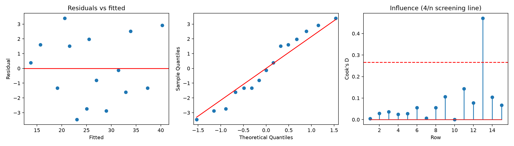
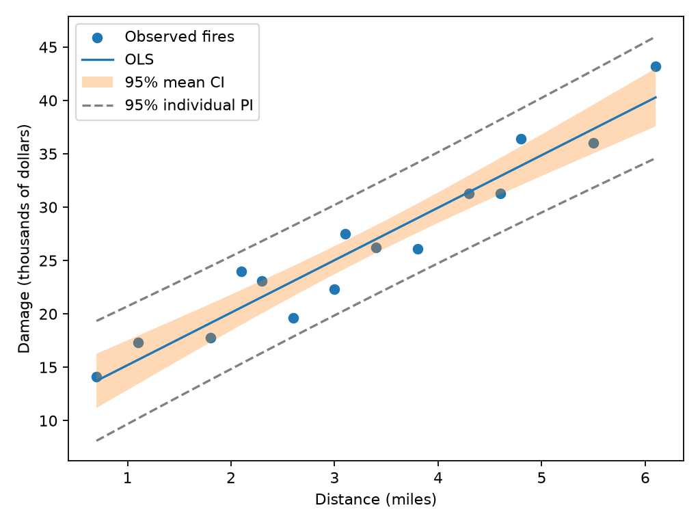
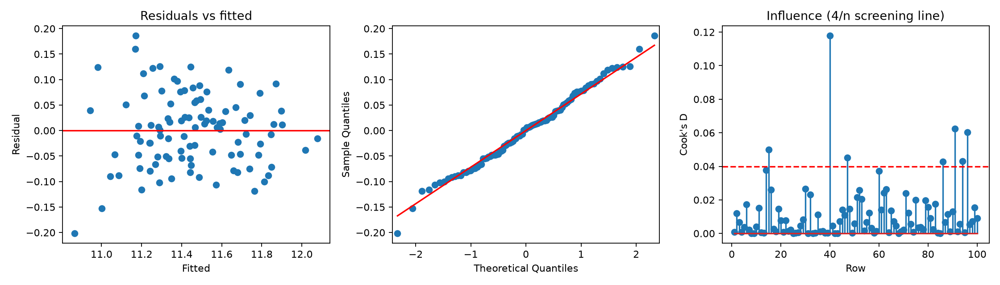
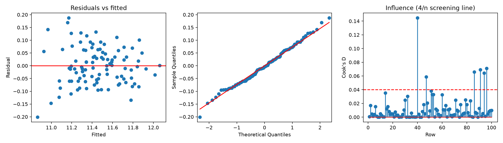

# STA 4155: worked Python example

Observational associations do not establish causation. Alpha = 0.05. Intervals assume the fitted model is appropriate.

## fires

Formula: `DAMAGE ~ DISTANCE`. n=15; R²=0.9235; adjusted R²=0.9176; overall F-test p=1.2478e-08.

Breusch-Pagan LM p=0.66955; Shapiro-Wilk p=0.47428. Small p-values flag possible violations; large p-values do not prove assumptions. Independence depends on sampling design and cannot be established by these tests.

See fires_summary.txt and coefficient/influence CSV files. Points above 4/n need review, not automatic deletion.

Overall hypothesis: all non-intercept slopes equal zero. Reject at 5%; the model provides evidence of association.

Diagnostic interpretation: the BP test does not detect unequal variance at 5%. Shapiro-Wilk does not reject normality at 5%.

Estimated damage = 10.2779 + 4.9193 × distance. One additional mile is associated with 4.9193 thousand dollars more damage on average. Slope p=1.2478e-08. The intercept may have little practical meaning if zero miles is outside the data range.

Mean confidence bands estimate average damage; wider prediction bands describe one new fire. Avoid extrapolation.

## salaries_full

Formula: `Y ~ X1 + X2 + X3 + X4 + X5 + X6 + X7 + X8 + X9 + X10`. n=100; R²=0.9229; adjusted R²=0.9142; overall F-test p=4.4078e-45.

Breusch-Pagan LM p=0.026528; Shapiro-Wilk p=0.90579. Small p-values flag possible violations; large p-values do not prove assumptions. Independence depends on sampling design and cannot be established by these tests.

See salaries_full_summary.txt and coefficient/influence CSV files. Points above 4/n need review, not automatic deletion.

Overall hypothesis: all non-intercept slopes equal zero. Reject at 5%; the model provides evidence of association.

Diagnostic interpretation: the constant-variance assumption is questioned by the BP test; compare the HC3 output. Shapiro-Wilk does not reject normality at 5%.

## salaries_exploratory_AIC

Formula: `Y ~ X1 + X2 + X3 + X4 + X5`. n=100; R²=0.9206; adjusted R²=0.9164; overall F-test p=4.2969e-50.

Breusch-Pagan LM p=0.00010617; Shapiro-Wilk p=0.9334. Small p-values flag possible violations; large p-values do not prove assumptions. Independence depends on sampling design and cannot be established by these tests.

See salaries_exploratory_AIC_summary.txt and coefficient/influence CSV files. Points above 4/n need review, not automatic deletion.

Overall hypothesis: all non-intercept slopes equal zero. Reject at 5%; the model provides evidence of association.

Diagnostic interpretation: the constant-variance assumption is questioned by the BP test; compare the HC3 output. Shapiro-Wilk does not reject normality at 5%.

## Salary interpretation

Y already contains natural log salary: do not log it again. ID is an identifier, excluded from predictors. X3, X6, X9 are binary indicators. Other coefficients adjust for all included predictors.

Full AIC=-221.049; exploratory reduced AIC=-228.139. Selected predictors: X1, X2, X3, X4, X5. Selection and evaluation use the same sample: reduced-model p-values and intervals ignore selection uncertainty. AIC improvement is not evidence of out-of-sample accuracy.

For each coefficient b, 100*(exp(b)-1) gives the modeled percentage change in median salary for a one-unit increase (or 0-to-1 indicator change), holding other variables fixed. Exponentiating a log prediction estimates median salary, not automatically mean salary. Currency units are not specified in the supplied variable table.

- X1: adjusted median salary change 2.83%; 95% CI [2.47%, 3.19%]; p=1.8372e-27.

- X2: adjusted median salary change 2.95%; 95% CI [2.25%, 3.65%]; p=4.5678e-13.

- X3: adjusted median salary change 25.15%; 95% CI [20.97%, 29.47%]; p=1.5214e-22.

- X4: adjusted median salary change 0.05%; 95% CI [0.04%, 0.06%]; p=3.909e-17.

- X5: adjusted median salary change 0.21%; 95% CI [0.10%, 0.31%]; p=0.0001856.

- X6: adjusted median salary change -1.53%; 95% CI [-4.77%, 1.83%]; p=0.36412.

- X7: adjusted median salary change -0.05%; 95% CI [-0.34%, 0.23%]; p=0.72379.

- X8: adjusted median salary change -0.26%; 95% CI [-1.27%, 0.76%]; p=0.6089.

- X9: adjusted median salary change -2.62%; 95% CI [-6.48%, 1.40%]; p=0.19561.

- X10: adjusted median salary change -0.10%; 95% CI [-0.68%, 0.49%]; p=0.74196.

## Review before writing your own report

Inspect residual shape, spread, Q-Q departures, VIF and influential cases. Consider robust HC3 standard errors if variance is unequal; they do not fix model misspecification. Check variable relevance and possible nonlinearities against course methods. Neither dataset supports a causal claim without additional design evidence.

Include your research questions, methods, numerical findings, limitations, relevant computer output, and group contributions. This example does not supply member names or invent contribution percentages.